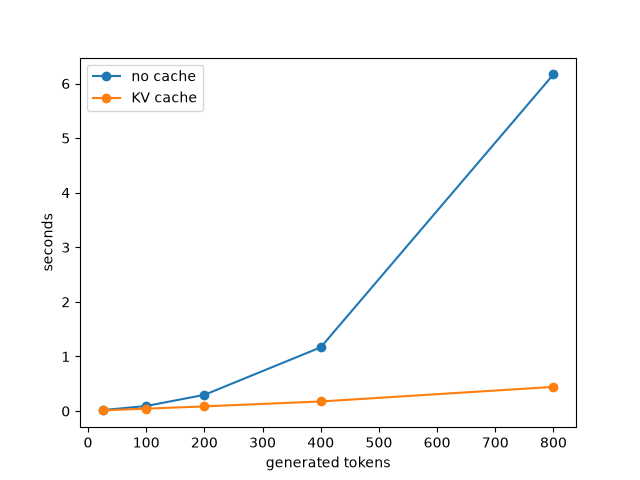
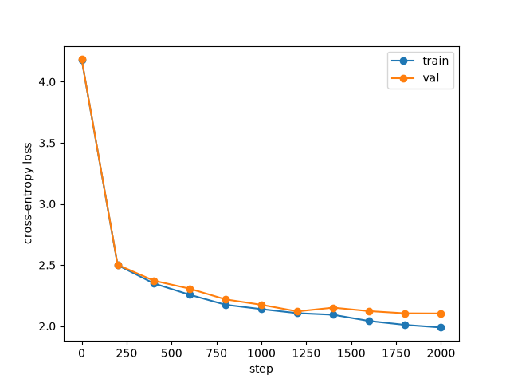

# mini-gpt-from-scratch

用 PyTorch 的基本張量運算，從零實作一個字元級 GPT（decoder-only Transformer），在莎士比亞劇本上訓練並生成文字，再實作 **KV Cache** 並量測它對生成速度與記憶體的影響。

沒有使用 `nn.Module`、`nn.MultiheadAttention` 或 `nn.TransformerDecoder`。注意力、遮罩、多頭拆併、RMSNorm、殘差連接、取樣策略、快取都是自己寫的，每一個矩陣乘法都能在程式裡直接看到。

## 重點結果

| 項目 | 結果 |
|---|---|
| 模型 | 2 層、4 頭、d_model 32，約 3 萬個參數 |
| 訓練 | 2000 步，21 秒（Apple M1 Pro CPU） |
| Loss | 初始 4.18（≈ ln 65，等於完全亂猜）→ Train **1.99** ／ Val **2.10** |
| KV Cache 加速 | 生成 800 個字：6.17 秒 → 0.44 秒（**13.9 倍**），輸出逐字相同 |
| KV Cache 記憶體 | 每個字 512 byte，實測值與公式完全一致 |

## 架構

```
token ids ──► Embedding + Position ──► [ Block ] × 2 ──► RMSNorm ──► Linear ──► logits
                                          │
                     ┌────────────────────┴────────────────────┐
                     │ x = x + MultiHeadAttention(RMSNorm(x))   │  causal mask
                     │ x = x + FeedForward(RMSNorm(x))          │  GELU, 4× 擴展
                     └─────────────────────────────────────────┘
```

- **Pre-norm**：先 Norm 再進子層，殘差路徑保持乾淨，訓練比較穩。
- **多頭一次算完**：Q/K/V 各用一個 `(D_MODEL, D_MODEL)` 矩陣，再 `reshape + transpose` 拆成 `(heads, seq, d_head)`，所有頭用一次批次矩陣乘法算完。
- **Causal mask**：上三角填 `-inf`，softmax 後變 0，每個位置只看得到自己和前面的字。
- **Softmax** 先減去每列最大值，避免 `exp` 溢位。

## KV Cache

生成時每一步只多一個字。因為有 causal mask，前面的字看不到後面的字，**前面每個字的 K、V 不會因為新字加入而改變**，可以存起來重用。

| | 沒有快取 | 有快取 |
|---|---|---|
| 每步要算 K/V 的字數 | 整段序列 | 只有新的 1 個字 |
| 每步 Attention 分數表 | (heads, n, n) | (heads, 1, n) |
| 需要遮罩 | 要 | 不用（快取裡只有過去的字） |

實作在 [`mini_gpt/kv_cache.py`](mini_gpt/kv_cache.py)：

- `cached_multi_head`：新字算 Q/K/V，把 K/V 用 `torch.cat` 接到該層快取後面，再用新字的 Q 對整個快取做 Attention。
- `forward_step`：一次只處理一個字，用絕對位置查位置表，每一層用自己的快取。
- `prefill`：提示文字整段一次算完，同時把每層的 K/V 整段存進快取；之後的 decode 再逐字生成。

### 生成速度（隨機權重，位置表加長到 1024）



| 生成字數 | 無快取（秒） | KV Cache（秒） | 加速 | 輸出相同 |
|---:|---:|---:|---:|:---:|
| 25 | 0.018 | 0.012 | 1.4x | ✅ |
| 100 | 0.093 | 0.044 | 2.1x | ✅ |
| 200 | 0.297 | 0.086 | 3.5x | ✅ |
| 400 | 1.168 | 0.176 | 6.6x | ✅ |
| 800 | 6.167 | 0.443 | 13.9x | ✅ |

沒有快取時，長度加倍、耗時變成 4～5 倍，成長速度接近平方或更快；有快取時長度加倍、耗時約 2 倍，接近線性。實測的加速倍數小於理論上「少算的 K/V 數量」的比例，因為每一步還有固定的 Python 迴圈和函式呼叫成本，序列短的時候這部分佔比更高。

### 記憶體

```
KV cache = 2 (K、V) × 層數 × 字數 × K/V 寬度 × 每個數字幾 byte
         = 2 × 2 × 807 × 32 × 4 = 413,184 byte   ← 與 tensor.numel() × element_size() 實測相同
```

- 每一步的 Attention 分數表，807 字時無快取需要 9.937 MB，有快取只需要 0.0123 MB。
- 用同一條公式推算公開設定的 Llama-3-8B（32 層、8 個 KV 頭 × 128、bf16）：每個字 128 KB，8192 字時約 **1 GB**。這是推算，不是實測。快取大小隨長度線性成長，這就是長對話會吃記憶體的原因。

### Prefill 與 Decode

| 提示字數 | 整段 Prefill（ms） | 逐字 Prefill（ms） | 之後 Decode 每字（ms） | 快取一致 |
|---:|---:|---:|---:|:---:|
| 50 | 1.43 | 18.32 | 0.376 | ✅ |
| 200 | 2.85 | 74.53 | 0.384 | ✅ |
| 800 | 16.83 | 382.90 | 0.570 | ✅ |

整段 Prefill 可以平行計算，800 字平均每字約 0.02 ms。Decode 每一步都要等前一個字生成完，沒辦法平行，每字約 0.5 ms。所以長提示時，**第一個字出來的延遲（TTFT）主要卡在 Prefill**，之後的生成速度則取決於 Decode。

**限制**：這裡用的是絕對位置表。總長度一旦超過位置表的列數，就只能改用滑動視窗，而視窗一移動，每個字的位置編號都會改變，存好的 K/V 就失效了。實際的大模型改用 RoPE 這類相對位置編碼，就是為了避開這個問題。

## 訓練



- 資料按前 90% / 後 10% 連續切分，驗證集的文字在訓練時完全沒看過。
- 每 200 步各抽 20 個 batch 評估 Train / Val Loss，評估時不更新權重。
- 最後 Train 1.99、Val 2.10，差距小，沒有明顯過擬合。
- 優化器用 AdamW，學習率 3e-3，weight decay 0.01，固定種子 0，可以重現。

### Warm-up 與梯度裁切（壓力測試，學習率拉高到 1e-2）

| 設定 | 最大梯度範數（step） | 最後 50 步平均 Loss | Val Loss |
|---|---:|---:|---:|
| none | 2.57 (20) | 2.3286 | 2.3160 |
| warmup | 1.20 (353) | 2.2515 | 2.2548 |
| clip | 2.81 (31) | 2.3231 | 2.2972 |
| warmup + clip | 1.36 (168) | 2.2556 | 2.2522 |

在這個小模型上，warm-up 讓初期的梯度峰值降到一半以下，最終 Loss 也比較低。裁切的上限是 1.0，它限制的是「更新量」，不是記錄到的梯度範數，所以這張表裡 clip 的最大範數沒有下降。只有一個種子、600 步，這只能說明趨勢，不能當作一般結論。

## 生成範例

Top-p（p=0.9、temperature 0.8），開頭是 `ROMEO:`：

```
ROMEO:
Thor mote whas selt me one me hang,
And gelst thance upose thoughtere hath goood
A have sone him senat's your welp a ancesend
```

學到了劇本格式、換行和常見的短字，但還不是完整的英文。以 3 萬個參數、2000 步來說，這是合理的程度。Greedy 很快就會陷入 `and the and the` 的重複迴圈，這也說明了為什麼需要隨機取樣、top-k 或 top-p。

## 執行

```bash
python -m venv .venv && source .venv/bin/activate
pip install -r requirements.txt
mkdir -p data && curl -o data/input.txt https://raw.githubusercontent.com/karpathy/char-rnn/master/data/tinyshakespeare/input.txt

python train.py                      # 訓練並存 checkpoints/mini_gpt.pt、assets/train_val_curve.png
python generate.py --strategy top_p  # greedy / sample / top_k / top_p
python benchmark.py                  # KV Cache 速度、記憶體、Prefill vs Decode
python experiment_warmup_clip.py     # warm-up / 梯度裁切對照
python -m unittest discover tests    # 7 個正確性測試
```

## 測試

[`tests/test_mini_gpt.py`](tests/test_mini_gpt.py)：

- 改動最後一個字，前面所有位置的輸出不變（causal mask 正確）。
- 初始 Loss ≈ ln(vocab)（初始化合理）。
- 有快取與無快取的 greedy 生成結果逐字相同。
- 整段 Prefill 與逐字 Prefill 的快取、logits 一致。
- 快取的 byte 數等於公式計算值。
- Top-k 剛好保留 k 個；Top-p 保留累積機率達到 p 的最小集合。

## 專案結構

```
mini_gpt/
  config.py      超參數
  data.py        字元 tokenizer、資料切分、取 batch
  model.py       attention、RMSNorm、多頭、FFN、Transformer block、forward、loss
  kv_cache.py    快取、單步 forward、prefill、記憶體計算
  sampling.py    greedy / temperature / top-k / top-p、有無快取的生成
  training.py    訓練迴圈、評估、warm-up、梯度裁切
train.py / generate.py / benchmark.py / experiment_warmup_clip.py
tests/
```

## 資料

[tiny-shakespeare](https://github.com/karpathy/char-rnn/tree/master/data/tinyshakespeare)，約 111 萬個字元，內容是莎士比亞劇本（公有領域）。資料不放進 repo，執行前依上面的指令下載。

## 環境

Python 3.13、PyTorch 2.14.1，在 MacBook Pro（M1 Pro, 16GB）的 CPU 上執行。表格裡的耗時是單次量測，換一台機器數字會不同，但趨勢應該一致。
